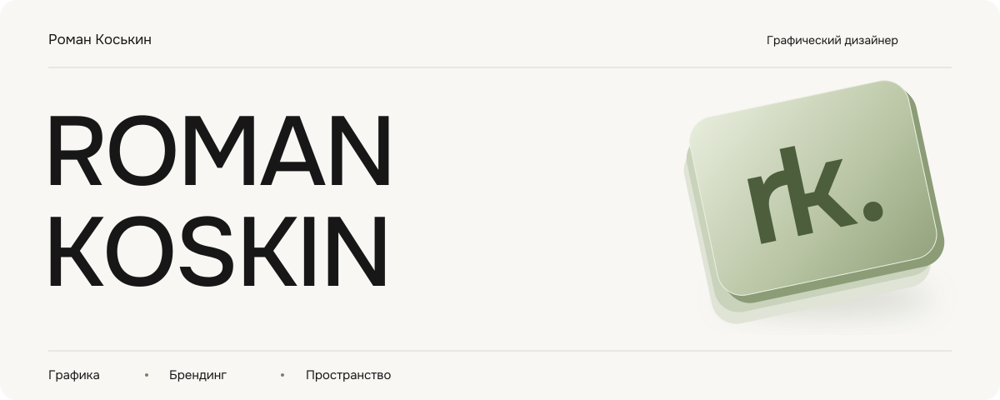
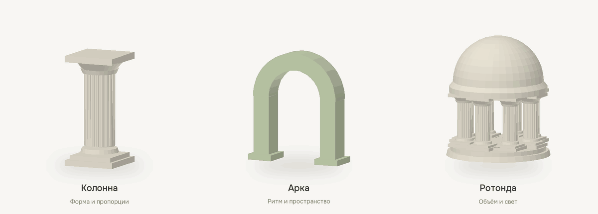

  

# Графический дизайн и пространства.

Авторский сайт **Романа Коськина** — дизайнера, который работает с афишами, логотипами, фирменным стилем, интерьерами и архитектурным проектированием.

Здесь можно познакомиться с автором, посмотреть направления его практики и обсудить будущий проект напрямую.

## Для кого этот сайт

- **Для бизнеса**, которому нужны логотип, фирменный стиль, афиши или презентация.
- **Для заказчиков интерьеров и архитектуры**, которые ищут помощь с пространством, планировкой и визуальной подачей.
- **Для студий и команд**, которым интересен дизайнер для совместной работы.

## Форма. Ритм. Объём.

  

Колонна, арка и ротонда раскрывают интерес Романа к архитектуре. На сайте их можно рассмотреть со всех сторон, менять материал и разбирать на детали — от цельной формы к её устройству.

## От знакомства к проекту

**Работы.** Подборка по направлениям: графика, брендинг и пространство. Фильтры помогают перейти к тому, что ближе вашей задаче.

**Автор.** Коротко о практике Романа: визуальные коммуникации, опыт работы в дизайнерских студиях и собственный барбершоп TRUEMAN в Подольске.

**Сотрудничество.** Можно описать задачу через форму, написать в Telegram или на почту. Обсудить идею, состав работ и следующий шаг.

## Визуальный характер

Тёплый светлый фон, крупная типографика и подпись **rk.** Много свободного пространства, плавные переходы и архитектурные объекты в объёме. Главный акцент — на авторе и его работах.

Часть обложек пока иллюстрирует направления практики. Подборку авторских материалов можно запросить у Романа.

---

**Обсудить проект** · [Telegram](https://t.me/Frisonscorpe) · [Почта](mailto:trueman.podolsk@bk.ru)
